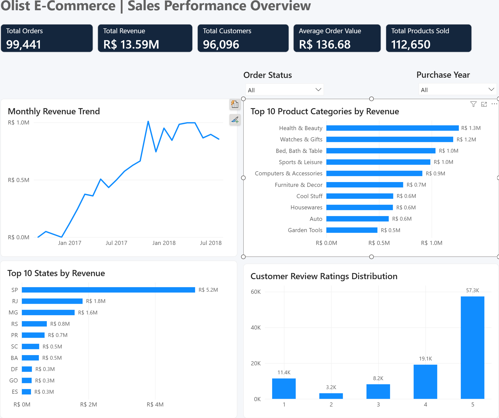
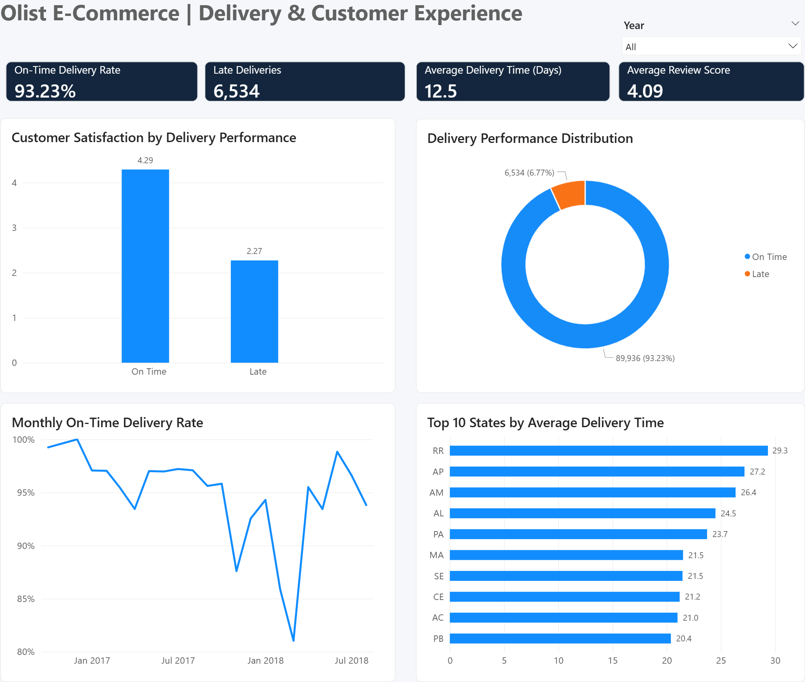
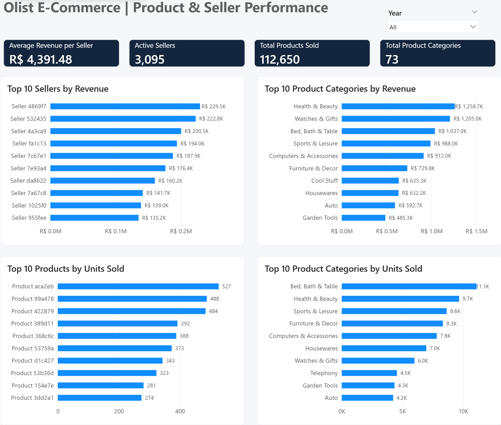

# Olist E-Commerce Analytics | PostgreSQL & Power BI

An end-to-end business intelligence portfolio project exploring order activity, product sales value, customer experience, delivery performance, and seller performance using the **Brazilian E-Commerce Public Dataset by Olist**.

## Project overview

This project uses **PostgreSQL 18 / pgAdmin 4** for exploratory analysis and data-quality checks, and **Power BI** for interactive reporting. The goal is to help an e-commerce business understand sales patterns, identify high-performing categories and sellers, and assess how delivery performance relates to customer satisfaction.

### Business questions

- How do order volume and sales value change over time?
- Which product categories, sellers, and customer states contribute most to product sales value?
- How frequently do customers return to place another order?
- How reliably are orders delivered by the estimated date, and how does this relate to review scores?
- Which payment methods and installment patterns are most common?
- Are the underlying data complete and relationally consistent?

## Tools and methods

**PostgreSQL 18 · pgAdmin 4 · SQL · Power Query · DAX · Power BI**

SQL techniques include joins, common table expressions (CTEs), window functions (`LAG`), conditional aggregation (`FILTER`), distinct counting, date calculations, ranking, and correlation (`CORR`). Power BI uses a relational data model, reusable DAX measures, year/status slicers, and interactive charts.

## Dataset

Source: [Brazilian E-Commerce Public Dataset by Olist (Kaggle)](https://www.kaggle.com/datasets/olistbr/brazilian-ecommerce).

The analysis uses nine related datasets: orders, order items, order payments, order reviews, customers, products, sellers, product category translations, and geolocation. The SQL script assumes these are loaded into PostgreSQL with table names such as `orders` and `order_items`. The Power BI model imports corresponding PostgreSQL tables.

## Power BI dashboard

### 1. Sales Performance Overview



**Reported KPIs (all years and order statuses):**

| Metric | Dashboard value |
|---|---:|
| Total orders | 99,441 |
| Product sales value (displayed as Total Revenue) | R$13.59M |
| Unique customers | 96,096 |
| Average order value | R$136.68 |
| Order items (displayed as Total Products Sold) | 112,650 |

Visuals: monthly product sales value, top 10 product categories by sales value, top 10 customer states by sales value, and review-score distribution. Filters: order status and purchase year.

### 2. Delivery & Customer Experience



| Metric | Dashboard value |
|---|---:|
| On-time delivery rate | 93.23% |
| On-time eligible deliveries | 89,936 |
| Late eligible deliveries | 6,534 |
| Average delivery time | 12.5 days |
| Average review score | 4.09 / 5 |

The dashboard compares review scores for on-time versus late deliveries (**4.29 versus 2.27**), tracks monthly on-time delivery rates, and compares average delivery times across states.

### 3. Product & Seller Performance



| Metric | Dashboard value |
|---|---:|
| Active sellers with recorded order items | 3,095 |
| Average product sales value per active seller | R$4,391.48 |
| Recorded order items | 112,650 |
| Nonblank product categories | 73 |

Visuals: top 10 sellers by sales value, top 10 categories by sales value, top 10 products by units ordered, and top 10 categories by units ordered. A purchase-year slicer supports comparison across periods.

## Key observations

- **Delivery experience and reviews are strongly associated in the dashboard:** orders delivered on time have an average review score of **4.29**, versus **2.27** for late deliveries. This is descriptive, not evidence that delays alone caused lower ratings.
- **On-time delivery is high overall:** **89,936 of 96,470** eligible delivered orders were on time (**93.23%**), leaving **6,534** late deliveries.
- **Product and seller concentration can be explored:** the dashboard ranks the top 10 categories, individual products, sellers, and customer states by their respective performance measures.
- **Category completeness matters:** excluding blank category values changes the overall distinct-category count from **74** to **73**.

## SQL analysis contents

The accompanying SQL script is organized into nine sections:

1. Order volume, monthly sales, and year-over-year trends
2. Customer geography, repeat purchases, and order frequency
3. Delivery punctuality, delivery duration, and state-level performance
4. Review distributions and customer satisfaction
5. Payment methods, transaction values, and installments
6. Product/category performance and review outcomes
7. Seller sales, delivery performance, reviews, and correlation analysis
8. Executive business, financial, delivery, and satisfaction KPIs
9. Data-quality checks for duplicate identifiers, missing values, and unmatched relationships

See [olist_ecommerce_analysis.sql](olist_ecommerce_analysis.sql).

## Metric definitions and limitations

- **Dashboard “Total Revenue”** is `SUM(order_items.price)`: the value of recorded product order items, **excluding freight**, without restricting to delivered orders. It is best interpreted as **product order value**, not audited recognized revenue or confirmed cash receipts.
- **Dashboard AOV** is product order value divided by the distinct count of all orders. Orders without matching order items can affect the denominator.
- **Dashboard “Total Products Sold”** counts order-item rows, including items associated with non-delivered orders; it represents **items ordered** rather than confirmed completed sales.
- **Dashboard on-time delivery** compares the *calendar dates* of actual and estimated delivery for delivered orders with both dates available. Some SQL queries compare full timestamps instead; these methods may classify deliveries differently near the estimated-date cutoff.
- **Dashboard average delivery time** uses DAX `DATEDIFF(..., DAY)`, which counts day boundaries; SQL uses elapsed seconds divided by 86,400. Minor differences are possible.
- **SQL revenue queries are not all defined the same way as the dashboard:** several use `order_payments.payment_value` for delivered orders, which can include amounts beyond product item prices. Do not compare those figures directly without aligning the population and definition.
- **Active sellers** means sellers appearing in the order-items data for the current filter context, not necessarily sellers currently operating.
- **Product category count** excludes blanks using `DISTINCTCOUNTNOBLANK`.
- This is a historical public dataset; the results do not describe current Olist operations.

## Reproduce the analysis

1. Download the Olist dataset from Kaggle and load the relevant CSV files into PostgreSQL.
2. Ensure the nine tables are named as expected by the SQL script, or update the queries to match your schema.
3. Run the SQL file in pgAdmin, section by section, to explore and validate the data.
4. Open the Power BI report and configure the PostgreSQL data-source connection for your own local database.
5. Refresh the model and review the dashboard measures, relationships, and slicers.

> **Connection note:** The `.pbix` may contain a local database server name, database name, and Power Query source settings. Review these before publishing. Database credentials should never be included in the repository.

## Repository files

```text
Olist-Ecommerce-Analytics/
├── README.md
├── sql/
│   └── olist_ecommerce_analysis.sql
├── powerbi/
│   └── Olist_Ecommerce_Analytics_Dashboard.pbix
└── screenshots/
    ├── 01_Sales_Performance_Overview.png
    ├── 02_Delivery_Customer_Experience.png
    └── 03_Product_Seller_Performance.png
```

## About this project

This portfolio project demonstrates SQL-based business analysis, relational data modeling, DAX measure design, data-quality validation, and interactive Power BI dashboard development.

**Dataset credit:** Olist, *Brazilian E-Commerce Public Dataset* (Kaggle).
